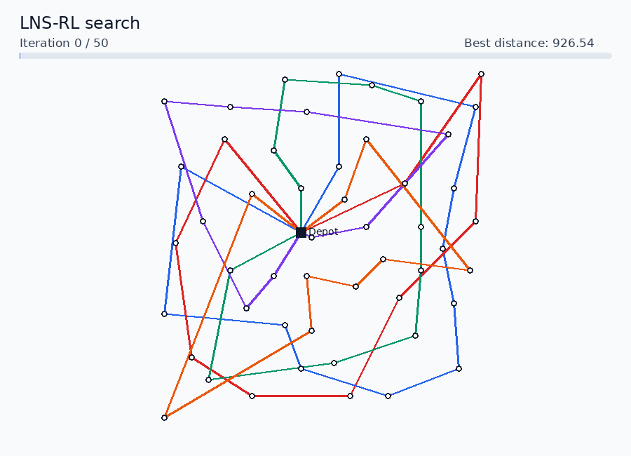

# LNS-RL Optimized

This repository contains the implementation, trained policy, benchmark data,
and evaluation results used for the LNS-RL experiments reported at KES 2025.
LNS-RL combines Large Neighbourhood Search (LNS) with a reinforcement-learning
policy that selects the customers removed at each search iteration.

This optimized edition preserves the published model and search logic while
removing the main runtime bottlenecks of the original research implementation.
In particular, one persistent Java repair worker is reused throughout the
search instead of starting a new JVM and exchanging files at every iteration.

The release supports Capacitated Vehicle Routing Problem (CVRP) instances in
CVRPLIB format.

## Associated paper

**A Deep Reinforcement Learning-based Large Neighborhood Search for Capacitated
Vehicle Routing Problems**

Asma Cherrered, Ammar Oulamara, and Wahiba Ramdane Cherif-Khettaf

Université de Lorraine, CNRS, LORIA, Nancy, France

Published in *Procedia Computer Science*, volume 270, pages 1568–1577, as part
of the 29th International Conference on Knowledge-Based and Intelligent
Information & Engineering Systems (KES 2025), Osaka, Japan.

- [Publication page](https://www.sciencedirect.com/science/article/pii/S1877050925029503)
- [DOI: 10.1016/j.procs.2025.09.277](https://doi.org/10.1016/j.procs.2025.09.277)



*Evolution of the best-known routes during a 1,000-iteration optimized LNS-RL
run on X-n143-k7 (142 customers).*

## Original and optimized implementations

The [`main`](https://github.com/Asma-CHER/LNSRL/tree/main) branch preserves the
original paper-oriented execution path. This
[`optimizer-runtime`](https://github.com/Asma-CHER/LNSRL/tree/optimizer-runtime)
branch retains the same checkpoint, policy architecture, features, search
parameters, and Java destroy/repair operators while optimizing their execution.

The optimized runner keeps one Java repair worker alive, avoids per-iteration
temporary-file exchange, caches static graph data, and removes the one-element
PyTorch `DataLoader`. These changes improve runtime without changing the
intended LNS-RL method. Because the Java implementation uses unseeded random
operations, neither branch is expected to reproduce bit-for-bit identical
search trajectories across independent executions.

## Repository contents

- the trained 11-feature LNS-RL policy used in the paper;
- 41 CMT, tai, and X benchmark instances with reference solutions;
- a command-line solver for evaluating individual CVRP instances;
- an optimized persistent Java/Python execution pipeline;
- the original KES 2025 results workbook and CSV exports; and
- an integrity checker for the published research artifacts.

## Requirements

- Python 3.10 or later
- Java JDK 11 or later (`java` and `javac` must be available on `PATH`)
- PyTorch and PyTorch Geometric for the selected CPU or CUDA environment

Create an isolated Python environment and install the dependencies:

```bash
cd LNS-RL-KES-Optimized
python -m venv .venv
source .venv/bin/activate
python -m pip install --upgrade pip
python -m pip install -r requirements.txt
```

## Quick start

Run the solver on the included CMT1 instance:

```bash
python solve.py \
  --instance data/paper_instances/CMT1.vrp \
  --solution data/paper_solutions/CMT1.sol \
  --device cpu \
  --output results/generated/CMT1.json \
  --animation results/generated/CMT1.gif
```

The default configuration matches the paper: 5,000 LNS iterations, two
anchors, an initial temperature of 100, and a final temperature of 1.

For a short test run, reduce the number of iterations:

```bash
python solve.py \
  --instance data/paper_instances/CMT1.vrp \
  --solution data/paper_solutions/CMT1.sol \
  --iterations 5 \
  --device cpu \
  --output results/generated/CMT1-test.json
```

To solve another CVRPLIB instance:

```bash
python solve.py \
  --instance /path/to/instance.vrp \
  --iterations 5000 \
  --output results/generated/solution.json
```

The reference `.sol` file is optional. When it is supplied, the generated JSON
also reports the reference cost and the percentage gap.

## Command-line options

| Option | Description | Paper default |
| --- | --- | ---: |
| `--instance` | Path to a CVRPLIB `.vrp` instance (required) | — |
| `--solution` | Path to the corresponding `.sol` file | None |
| `--model` | Policy checkpoint to load | `models/lns_rl_kes.pth` |
| `--iterations` | Number of LNS iterations | `5000` |
| `--anchors` | Number of learned removal anchors | `2` |
| `--initial-temperature` | Initial simulated-annealing temperature | `100` |
| `--final-temperature` | Final simulated-annealing temperature | `1` |
| `--seed` | NumPy and PyTorch random seed | `0` |
| `--torch-threads` | CPU threads used by PyTorch | `1` |
| `--device` | PyTorch device, such as `cpu`, `cuda`, or `cuda:0` | Auto-detected |
| `--output` | Destination for the JSON result | `results/generated/solution.json` |
| `--animation` | Optional destination for a GIF of the best route during search | None |
| `--animation-every` | Number of iterations between GIF frames | About 60 frames per run |

Run `python solve.py --help` to display the options in the terminal.

## Output

Each run prints its result and saves it as JSON. The output includes the best
distance and routes, search configuration, accepted and improving move counts,
and model identifier. When a reference solution is provided, it also includes
`reference_cost` and `gap_percent`.

When `--animation` is supplied, the solver also creates an animated GIF showing
how the best-known routes evolve over the sampled search iterations. Every
frame reports the actual elapsed search time while retaining a fixed playback
duration of 180 ms. Animation generation is optional and does not change the
search decisions.

## Runtime optimization

The optimized runner:

- starts one Java repair worker per solve rather than one JVM per iteration;
- loads the instance and distance matrix into Java only once;
- exchanges repair requests through buffered standard input/output;
- avoids temporary state files inside the iteration loop;
- sends the graph directly to the policy without constructing a one-item
  `DataLoader` at every iteration;
- caches the static neighbourhood edge tensor; and
- recompiles Java sources only when they have changed.

The trained checkpoint, neural-network architecture, features, destroy/repair
operators, acceptance criterion, and paper defaults are unchanged. See
[OPTIMIZATION.md](OPTIMIZATION.md) for validation and benchmark details.

## Paper evaluation protocol

The reported evaluation used:

- 41 CVRP benchmarks from the CMT, tai, and X families;
- 10 independent runs per instance;
- 5,000 LNS iterations per run;
- two learned anchors and 11 node/route features; and
- simulated annealing with temperatures decreasing from 100 to 1.

The Java initializer has its own random-number generator. Consequently,
`--seed` controls NumPy and PyTorch but does not make the complete Java/Python
execution bitwise deterministic. Use multiple independent runs when
regenerating aggregate results.

## Reproducing the paper experiments

First verify that the checkpoint, workbook, and all 41 benchmark pairs are the
published artifacts:

```bash
python verify_release.py
```

The following command runs the paper configuration 10 times on every included
instance. It performs 410 solver executions and may take several hours. Set
`--device cuda` instead of `--device cpu` if a compatible CUDA environment is
available.

```bash
mkdir -p results/generated/paper_reproduction

for instance_path in data/paper_instances/*.vrp; do
  instance_file="${instance_path##*/}"
  instance_name="${instance_file%.vrp}"

  for run in $(seq 0 9); do
    python solve.py \
      --instance "$instance_path" \
      --solution "data/paper_solutions/${instance_name}.sol" \
      --iterations 5000 \
      --anchors 2 \
      --initial-temperature 100 \
      --final-temperature 1 \
      --seed "$run" \
      --device cpu \
      --output "results/generated/paper_reproduction/${instance_name}_run_${run}.json"
  done
done
```

Each JSON file contains the best distance, reference cost, percentage gap,
routes, and search statistics for one execution. The `--seed` option controls
NumPy and PyTorch; the Java initialization and repair code remain stochastic.
Consequently, reproduction should compare aggregate results across independent
runs rather than expect identical routes from the historical evaluation.

The unchanged historical tables are available in
`results/Results_KES2025.xlsx`, with CSV exports in the same directory.

## Published artifacts

The exact trained policy is stored at `models/lns_rl_kes.pth`. The unchanged
workbook used to prepare the paper tables is available at
`results/Results_KES2025.xlsx`. Its four sheets are also provided as CSV files:

- `kes2025_all.csv` — complete best, average, and execution-time results;
- `paper_best.csv` — best-solution table;
- `paper_average.csv` — average-solution table; and
- `paper_average_cpu.csv` — average execution-time table.

Verify the checkpoint, workbook, and benchmark dataset at any time with:

```bash
python verify_release.py
```

The integrity checker compares the artifacts with their SHA-256 fingerprints.
These fingerprints identify the exact files used for the published results;
they are not solver parameters.

## Project structure

```text
.
├── solve.py                      # Single-instance evaluation entry point
├── OPTIMIZATION.md               # Optimization design and validation
├── verify_release.py             # Research-artifact integrity checks
├── lib/                          # LNS-RL policy and CVRP environment
├── JAVA/                         # Repair operators and persistent worker
├── models/lns_rl_kes.pth         # Trained policy used in the paper
├── data/paper_instances/         # 41 benchmark instances
├── data/paper_solutions/         # Corresponding reference solutions
└── results/                      # Published workbook and CSV exports
```

## Citation

If you use this implementation or its published artifacts, please cite:

```bibtex
@article{cherrered2025deep,
  title   = {A Deep Reinforcement Learning-based Large Neighborhood Search for
             Capacitated Vehicle Routing Problems},
  author  = {Cherrered, Asma and Oulamara, Ammar and
             Cherif-Khettaf, Wahiba Ramdane},
  journal = {Procedia Computer Science},
  volume  = {270},
  pages   = {1568--1577},
  year    = {2025},
  publisher = {Elsevier},
  doi     = {10.1016/j.procs.2025.09.277},
  url     = {https://doi.org/10.1016/j.procs.2025.09.277}
}
```

## License

This project is released under the MIT License. See [LICENSE](LICENSE) for
details.
